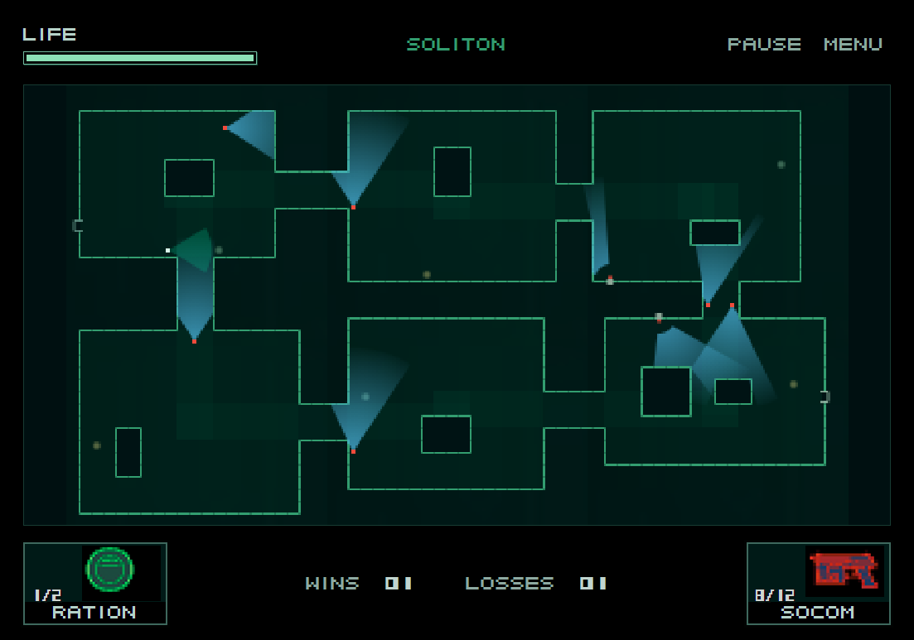
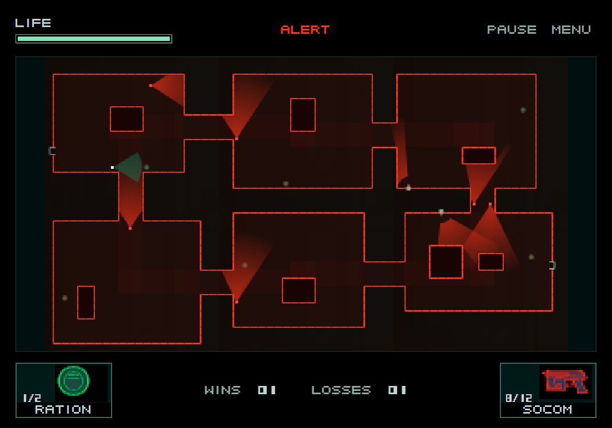
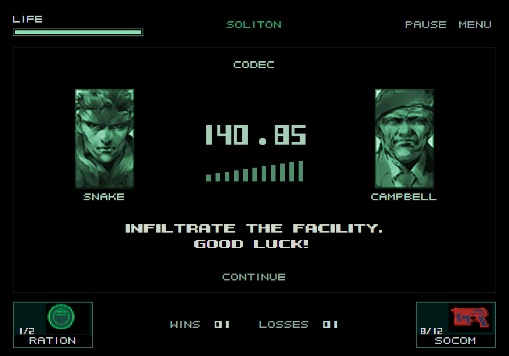

# Soliton

Watch Snake sneak through a different facility each run. He slips through vents, grabs keycards and tries to reach the exit before the patrols catch him. Soliton is a small, autonomous stealth game inspired by the radar in *Metal Gear Solid*.

**[Download for Windows x64](https://github.com/Phobiastrike/Soliton/releases/latest)** · Extract the whole ZIP and run **Soliton.exe**. The game runs offline and saves your record beside the executable. You can pause with **Space**, mute with **M**, or open the options with **Esc**.

*Infiltration.* The white dot is Snake. Blue cones show where guards and security cameras can see.

*Alert.* Red means Snake has been spotted. When the patrol loses sight of him, the radar turns yellow while the search continues.

*CODEC, 140.85.* Colonel Campbell briefs Snake at the start of each sector. You can switch off calls in the options.

Unofficial fan project. [Credits and asset sources](CREDITS.md).
